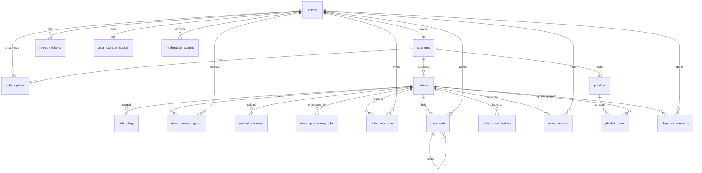

# Database Design

**Status: design only. Nothing in this document is implemented.**

PostgreSQL 16 is the system of record. Video bytes are not stored in the database. Object keys are.

Conventions:

- Primary keys are UUID v7, generated in the application (ADR-021).
- Timestamps are `timestamptz`, stored in UTC.
- Enumerations are PostgreSQL enum types. Values match the API.
- Soft delete uses `deleted_at` where noted. Other tables are hard-deleted only by explicit maintenance jobs.
- `updated_at` is set by the application on change.
- Money is not stored. Counts are `bigint` or `integer` and are never negative.

Extensions: `citext`, `pg_trgm`. Full-text search uses the built-in `simple` configuration. `pgcrypto` is not required.

## 1. Entity relationship diagram



## 2. Enumerations

```text
user_role:        USER | MODERATOR | ADMIN
visibility:       public | unlisted | private
processing_status: draft | uploading | uploaded | processing | ready | failed | abandoned
moderation_status: visible | hidden
upload_status:    initiated | completing | completed | aborted | expired
job_status:       queued | running | succeeded | failed | cancelled
failure_class:    retryable | fatal
reaction_value:   like | dislike
report_reason:    spam | harassment | violence | sexual | copyright | other
report_status:    open | dismissed | action_taken
playlist_visibility: public | unlisted | private
```

`processing_status` and `moderation_status` are separate so a hide does not destroy processing state, and a processing failure is not confused with a moderation decision.

## 3. Tables

### 3.1 `users`

| Column | Type | Notes |
| --- | --- | --- |
| `id` | uuid PK | |
| `email` | citext | unique, not null |
| `password_hash` | text | Argon2id encoded string, not null |
| `role` | user_role | not null, default `USER` |
| `is_active` | boolean | not null, default true |
| `session_epoch` | integer | not null, default 1, check `>= 1` |
| `created_at` | timestamptz | not null |
| `updated_at` | timestamptz | not null |

`session_epoch` increments on logout, deactivation, and ban. Access tokens carry the epoch and are rejected when it does not match. See [SECURITY_DESIGN.md](SECURITY_DESIGN.md).

The channel handle and display name live on `channels`, not here. Deactivation does not delete the row.

### 3.2 `refresh_tokens`

| Column | Type | Notes |
| --- | --- | --- |
| `id` | uuid PK | |
| `user_id` | uuid | FK `users.id`, not null |
| `token_hash` | bytea | SHA-256 of the opaque token, unique, not null |
| `family_id` | uuid | not null. All rotations of one login share a family |
| `expires_at` | timestamptz | not null |
| `revoked_at` | timestamptz | null until logout, reuse, or ban |
| `replaced_by_id` | uuid | FK `refresh_tokens.id`, null |
| `created_at` | timestamptz | not null |

The raw token is returned once and stored only as a hash. Reuse of a revoked token revokes every row in the same `family_id`.

### 3.3 `channels`

| Column | Type | Notes |
| --- | --- | --- |
| `id` | uuid PK | |
| `user_id` | uuid | unique FK `users.id`, not null |
| `handle` | citext | unique, not null |
| `name` | varchar(80) | not null |
| `description` | varchar(2000) | not null, default `''` |
| `avatar_object_key` | text | null |
| `subscriber_count` | bigint | not null, default 0, check `>= 0` |
| `search_vector` | tsvector | generated from `name` and `handle` |
| `created_at` | timestamptz | not null |
| `updated_at` | timestamptz | not null |

Handle check: `handle ~ '^[a-z0-9_]{3,30}$'`. Handles are stored lowercase. Immutable after insert in the first release (no update path in the service).

`subscriber_count` is denormalized. It changes only in the same transaction as a subscription insert or delete (ADR-009).

### 3.4 `user_storage_quotas`

| Column | Type | Notes |
| --- | --- | --- |
| `user_id` | uuid PK | FK `users.id` |
| `bytes_committed` | bigint | not null, default 0, check `>= 0` |
| `bytes_reserved` | bigint | not null, default 0, check `>= 0` |
| `bytes_limit` | bigint | not null, check `> 0` |

Created in the same transaction as the user. Reservation rules are in [VIDEO_PIPELINE.md](VIDEO_PIPELINE.md). The check `bytes_committed + bytes_reserved <= bytes_limit` is enforced in the service under `SELECT ... FOR UPDATE`, not as a table check, because reservations move between columns.

### 3.5 `subscriptions`

| Column | Type | Notes |
| --- | --- | --- |
| `subscriber_user_id` | uuid | FK `users.id` |
| `channel_id` | uuid | FK `channels.id` |
| `created_at` | timestamptz | not null |

Primary key `(subscriber_user_id, channel_id)`.

A trigger or a service check rejects a row whose subscriber is the channel owner. The service check is the primary guard. A trigger is added so a bad repository call cannot subscribe a user to themselves:

```text
BEFORE INSERT: reject when subscriber_user_id =
  (select user_id from channels where id = channel_id)
```

### 3.6 `videos`

| Column | Type | Notes |
| --- | --- | --- |
| `id` | uuid PK | |
| `channel_id` | uuid | FK `channels.id`, not null |
| `title` | varchar(100) | not null, check `char_length(title) >= 1` |
| `description` | varchar(5000) | not null, default `''` |
| `visibility` | visibility | not null, default `private` |
| `processing_status` | processing_status | not null, default `draft` |
| `moderation_status` | moderation_status | not null, default `visible` |
| `acl_version` | integer | not null, default 1 |
| `duration_seconds` | integer | null until probed, check `> 0` when set |
| `width` | integer | null |
| `height` | integer | null |
| `view_count` | bigint | not null, default 0, check `>= 0` |
| `like_count` | integer | not null, default 0, check `>= 0` |
| `dislike_count` | integer | not null, default 0, check `>= 0` |
| `comment_count` | integer | not null, default 0, check `>= 0` |
| `original_object_key` | text | null until upload starts |
| `hls_master_key` | text | null until processing succeeds |
| `auto_thumbnail_key` | text | null |
| `custom_thumbnail_key` | text | null |
| `source_byte_size` | bigint | null, check `> 0` when set |
| `source_content_type` | text | null. Declared type, checked against the allow-list at upload |
| `source_sha256` | varchar(64) | null until the worker hashes the downloaded original. Check `^[a-f0-9]{64}$` |
| `published_at` | timestamptz | set when status first becomes `ready` |
| `search_vector` | tsvector | generated from `title` and `description` |
| `deleted_at` | timestamptz | null |
| `storage_released_at` | timestamptz | null until object cleanup finishes |
| `created_at` | timestamptz | not null |
| `updated_at` | timestamptz | not null |

New videos default to `private` so a half-uploaded video is never public (ADR-013).

`published_at` does not change if the owner later edits the title. The feed sorts by `published_at`, then `id`.

Display thumbnail is `custom_thumbnail_key` when set, otherwise `auto_thumbnail_key`.

Allowed processing transitions are enforced in the service, not by a trigger, because several transitions depend on job rows:

```text
draft → uploading → uploaded → processing → ready
draft → abandoned
uploading → abandoned
uploading → failed             (part or size verification rejected)
uploaded → processing
processing → uploaded          (stale lock or retryable failure)
processing → failed            (fatal, or attempts exhausted)
failed → uploaded              (owner retry, only when the original object exists)
any non-abandoned → stays itself on metadata edit
```

`ready → processing` is not allowed in the first release. Replacing the binary means delete and upload again. A video that reached `failed` from upload verification has no original, so the owner retry edge does not apply. The owner deletes it and starts a new upload.

### 3.7 `video_tags`

| Column | Type | Notes |
| --- | --- | --- |
| `video_id` | uuid | FK `videos.id` |
| `tag` | varchar(30) | not null |

Primary key `(video_id, tag)`. Tag check: `tag ~ '^[a-z0-9][a-z0-9-]{0,29}$'`. Maximum 15 tags per video, enforced in the service. Index on `tag` for related-video lookup.

### 3.8 `video_access_grants`

| Column | Type | Notes |
| --- | --- | --- |
| `id` | uuid PK | |
| `video_id` | uuid | FK `videos.id`, not null |
| `grantee_user_id` | uuid | FK `users.id`, not null |
| `granted_by_user_id` | uuid | FK `users.id`, not null |
| `created_at` | timestamptz | not null |
| `revoked_at` | timestamptz | null while active |

Partial unique index:

```sql
CREATE UNIQUE INDEX video_grants_active_uidx
  ON video_access_grants (video_id, grantee_user_id)
  WHERE revoked_at IS NULL;
```

The owner is not inserted as a grantee. Access rules:

- owner always
- active grant only when `visibility = private`
- moderator or admin only through a moderation route, and only with an audit row

Revocation sets `revoked_at` and increments `videos.acl_version`. Rows are kept so the owner can see who had access.

A check constraint rejects `grantee_user_id = granted_by_user_id` only when that would mean self-grant. Self-grant is rejected in the service because the owner already has access. The grantee must not be the channel owner.

### 3.9 `upload_sessions`

| Column | Type | Notes |
| --- | --- | --- |
| `id` | uuid PK | |
| `video_id` | uuid | FK `videos.id`, not null |
| `object_key` | text | not null. Always `originals/{video_id}/source` |
| `s3_upload_id` | text | null until `CreateMultipartUpload` returns |
| `expected_size` | bigint | not null, check `> 0` |
| `part_size` | integer | not null, check `= 16777216` |
| `part_count` | integer | not null, check between 1 and 512 |
| `status` | upload_status | not null |
| `error_code` | text | null. Set to `upload_rejected` when part or size verification fails |
| `completion_token` | uuid | null. Identifies the request that moved the session to `completing` |
| `completion_started_at` | timestamptz | null |
| `expires_at` | timestamptz | not null |
| `created_at` | timestamptz | not null |
| `completed_at` | timestamptz | null |

Checks, so a buggy writer cannot store a session whose geometry does not match the signed part lengths:

```text
expected_size > (part_count - 1)::bigint * part_size
expected_size <= part_count::bigint * part_size
```

`part_count::bigint` is required because `512 * 16777216` does not fit in a 32-bit integer.

Partial unique index: one session in `initiated` or `completing` per video.

```sql
CREATE UNIQUE INDEX upload_sessions_one_active_uidx
  ON upload_sessions (video_id)
  WHERE status IN ('initiated', 'completing');
```

```sql
CREATE UNIQUE INDEX upload_sessions_s3_upload_uidx
  ON upload_sessions (s3_upload_id)
  WHERE s3_upload_id IS NOT NULL;
```

Completion locks this row with `FOR UPDATE`. Two overlapping complete calls serialize on that lock. The details are in [VIDEO_PIPELINE.md](VIDEO_PIPELINE.md). Quota is released only after SeaweedFS has aborted the upload or the object is confirmed gone, except the success path, which moves `expected_size` from `bytes_reserved` to `bytes_committed` after `HEAD` matches exactly.

### 3.10 `video_processing_jobs`

| Column | Type | Notes |
| --- | --- | --- |
| `id` | uuid PK | |
| `video_id` | uuid | FK `videos.id`, not null |
| `attempt` | integer | not null, check `>= 1` |
| `status` | job_status | not null |
| `failure_class` | failure_class | null |
| `error_code` | text | null |
| `error_detail` | text | null, truncated |
| `locked_by` | text | worker id, null |
| `locked_until` | timestamptz | null |
| `next_run_at` | timestamptz | not null |
| `started_at` | timestamptz | null |
| `finished_at` | timestamptz | null |
| `created_at` | timestamptz | not null |

Partial unique index: at most one `queued` or `running` job per video.

```sql
CREATE UNIQUE INDEX jobs_one_active_uidx
  ON video_processing_jobs (video_id)
  WHERE status IN ('queued', 'running');
```

Claim index:

```sql
CREATE INDEX jobs_claim_idx
  ON video_processing_jobs (next_run_at, created_at)
  WHERE status = 'queued';
```

Lifetime cap: the service refuses to insert a job when the video already has 6 job rows. Three are automatic. Three more can be owner retries.

### 3.11 `video_reactions`

| Column | Type | Notes |
| --- | --- | --- |
| `user_id` | uuid | FK `users.id` |
| `video_id` | uuid | FK `videos.id` |
| `value` | reaction_value | not null |
| `created_at` | timestamptz | not null |
| `updated_at` | timestamptz | not null |

Primary key `(user_id, video_id)`. Changing `like` to `dislike` updates both counters in the same transaction as the row update. Clearing a reaction deletes the row and decrements the matching counter.

### 3.12 `comments`

| Column | Type | Notes |
| --- | --- | --- |
| `id` | uuid PK | |
| `video_id` | uuid | FK `videos.id`, not null |
| `user_id` | uuid | FK `users.id`, not null |
| `parent_id` | uuid | FK `comments.id`, null |
| `body` | varchar(2000) | not null, check length between 1 and 2000 |
| `created_at` | timestamptz | not null |
| `updated_at` | timestamptz | not null |
| `deleted_at` | timestamptz | null |

Replies: `parent_id` must reference a comment with the same `video_id` and a null `parent_id`. Enforced in the service. One level only.

Deleting a parent soft-deletes it and keeps replies. The API renders a deleted parent as "Comment deleted" when replies exist, and omits it when it has no remaining replies.

`comment_count` counts non-deleted rows and moves in the same transaction as insert or soft delete.

Index: `(video_id, created_at, id)` for chronological pages.

### 3.13 `video_view_dedupe`

| Column | Type | Notes |
| --- | --- | --- |
| `video_id` | uuid | FK `videos.id` |
| `viewer_key` | bytea | not null |
| `last_viewed_at` | timestamptz | not null |

Primary key `(video_id, viewer_key)`.

`viewer_key` is SHA-256 of `user:{uuid}` or `anon:{daily_salt}:{ip}:{user_agent}`. The salt rotates daily and is kept for 48 hours so yesterday's key still matches during the window. Rows older than 48 hours are deleted by the sweeper.

A view increment happens only when no row exists or `last_viewed_at` is older than 6 hours, and only if the caller can watch the video and the client reports playback started.

This table can grow quickly. The 48 hour delete is required, not optional. If growth is still a problem, a later release can move dedupe to Redis. That move is not part of this design.

### 3.14 `video_reports`

| Column | Type | Notes |
| --- | --- | --- |
| `id` | uuid PK | |
| `video_id` | uuid | FK `videos.id`, not null |
| `reporter_user_id` | uuid | FK `users.id`, not null |
| `reason` | report_reason | not null |
| `details` | varchar(2000) | null |
| `status` | report_status | not null, default `open` |
| `created_at` | timestamptz | not null |
| `resolved_at` | timestamptz | null |

Partial unique index: one open report per reporter per video.

```sql
CREATE UNIQUE INDEX reports_one_open_uidx
  ON video_reports (video_id, reporter_user_id)
  WHERE status = 'open';
```

The reporter cannot be the channel owner. Enforced in the service.

### 3.15 `playlists`

| Column | Type | Notes |
| --- | --- | --- |
| `id` | uuid PK | |
| `channel_id` | uuid | FK `channels.id`, not null |
| `title` | varchar(100) | not null |
| `description` | varchar(2000) | not null, default `''` |
| `visibility` | playlist_visibility | not null, default `private` |
| `created_at` | timestamptz | not null |
| `updated_at` | timestamptz | not null |

No per-user playlist grants in the first release. `private` means the owning user only.

### 3.16 `playlist_items`

| Column | Type | Notes |
| --- | --- | --- |
| `playlist_id` | uuid | FK `playlists.id` |
| `video_id` | uuid | FK `videos.id` |
| `position` | integer | not null |
| `created_at` | timestamptz | not null |

Primary key `(playlist_id, video_id)`. Unique `(playlist_id, position)`.

Positions are spaced by 1000 so inserts between items do not renumber the whole playlist. The service rebalances if a gap is exhausted. That case is rare and handled in application code.

A user may add a video they are allowed to watch. Readers still need access to each video. An entry the reader cannot watch is returned as an unavailable placeholder without title or thumbnail when the video is private, and is omitted from public playlist views when the video is not `ready` or is hidden or deleted.

### 3.17 `playback_sessions`

| Column | Type | Notes |
| --- | --- | --- |
| `id` | uuid PK | random uuid v4, the cookie value |
| `user_id` | uuid | FK `users.id`, null for anonymous public playback |
| `video_id` | uuid | FK `videos.id`, not null |
| `expires_at` | timestamptz | not null |
| `revoked_at` | timestamptz | null |
| `created_at` | timestamptz | not null |

Index `(user_id)` where `revoked_at is null` for logout. Index `(expires_at)` for the sweeper.

The cookie is `hls_session=<id>` with `Path=/api/v1/videos/{video_id}/hls`, `HttpOnly`, `SameSite=Lax`, and `Secure` when `COOKIE_SECURE=true`.

Logout and ban set `revoked_at` on every active session for that user.

### 3.18 `moderation_actions`

| Column | Type | Notes |
| --- | --- | --- |
| `id` | uuid PK | |
| `actor_user_id` | uuid | FK `users.id`, not null |
| `action` | text | not null. Closed set enforced by check |
| `target_type` | text | not null. `video`, `report`, `user` |
| `target_id` | uuid | not null |
| `reason` | varchar(2000) | not null |
| `metadata` | jsonb | not null, default `{}` |
| `created_at` | timestamptz | not null |

`action` check constraint:

```text
hide_video | restore_video | dismiss_report |
change_role | deactivate_user | reactivate_user |
view_private_video
```

`view_private_video` is written when a moderator opens a private or hidden video from the moderation UI.

Indexes: `(target_type, target_id, created_at)`, `(actor_user_id, created_at)`.

Append-only is enforced in the database:

```text
BEFORE UPDATE OR DELETE ON moderation_actions
  → raise exception
```

The application database role is the table owner, so application convention alone cannot stop an update. The trigger can. This is intentional (ADR-012).

## 4. Foreign keys and delete behavior

All foreign keys are `ON DELETE RESTRICT`.

Users, channels, and videos are not hard-deleted in normal operation. Cascading deletes would erase audit history or hide a failed cleanup. The sweeper deletes objects only after `deleted_at` is set, and it does not delete the video row in the first release.

`replaced_by_id` on refresh tokens is `ON DELETE RESTRICT` as well. Refresh rows are revoked, not deleted, until a maintenance job removes rows expired for more than 30 days. That job deletes only rows that are not referenced by `replaced_by_id`, or it nulls `replaced_by_id` first inside a single maintenance transaction. Implementation chooses null-then-delete during that stage.

## 5. Indexes

Beyond primary keys, unique constraints, and the partial indexes above:

| Index | Purpose |
| --- | --- |
| `videos_feed_idx` on `(published_at desc, id desc)` where `processing_status = ready` and `moderation_status = visible` and `visibility = public` and `deleted_at is null` | Home feed |
| `videos_channel_idx` on `(channel_id, published_at desc, id desc)` where `deleted_at is null` | Channel video list. Visibility filter is applied in the query because owners see more than the public does |
| `videos_search_idx` GIN on `search_vector` | Video search |
| `refresh_tokens_family_id_idx` on `(family_id)` | Family revocation |
| `refresh_tokens_user_id_idx` on `(user_id)` | Logout and deactivation |
| `channels_search_idx` GIN on `search_vector` | Channel search |
| `channels_handle_trgm` GIN on `handle` using `gin_trgm_ops` | Handle prefix and typo tolerance |
| `channels_name_trgm` GIN on `name` using `gin_trgm_ops` | Channel name search |
| `upload_sessions_expire_idx` on `(expires_at)` where status in `initiated`, `completing` | Sweeper |
| `videos_cleanup_idx` on `(deleted_at)` where `deleted_at is not null` and `storage_released_at is null` | Object cleanup |
| `playback_sessions_expire_idx` on `(expires_at)` where `revoked_at is null` | Sweeper |
| `video_view_dedupe_expire_idx` on `(last_viewed_at)` | Sweeper |
| `comments_video_idx` on `(video_id, created_at, id)` where `deleted_at is null` | Comment pages |

Feed and search queries must be checked with `EXPLAIN` during the catalogue stage. If the partial feed index is not used, the query is fixed before that stage is accepted.

## 6. Transaction boundaries

| Use case | Transaction contents |
| --- | --- |
| Register | Insert user, channel, quota |
| Subscribe | Insert subscription, `subscriber_count = subscriber_count + 1` |
| Unsubscribe | Delete subscription, decrement count, guarded so the count cannot go negative |
| Set reaction | Upsert or delete reaction, adjust `like_count` and `dislike_count` with a single `UPDATE` |
| Add comment | Insert comment, increment `comment_count` |
| Begin upload | Lock quota, reserve `expected_size`, insert session. `CreateMultipartUpload` happens after this commit. A follow-up transaction stores `s3_upload_id` |
| Start complete | Lock the session. One caller sets `completing` and `completion_token`. A caller that finds `completed` returns the current video. A caller that finds a recent `completing` row receives `UPLOAD_IN_PROGRESS` |
| Finish complete | After `ListParts` and `HEAD` match `expected_size`: session `completed`, move reservation to `bytes_committed`, video `uploaded`, insert one job |
| Reject complete | After SeaweedFS abort succeeds: session `aborted`, reservation released, video `failed`, `error_code = upload_rejected`. No job. If abort fails, the reservation stays and the sweeper retries |
| Finalize job | Set job `succeeded`, set video `ready`, set media keys, set `published_at` if null |
| Hide video | Set `hidden`, increment `acl_version`, resolve targeted reports, insert audit |
| Change role | Update `users.role` and insert the audit row. Sessions stay valid. The next request reads the new role |
| Logout | Revoke the refresh family, revoke the user's playback sessions, and increment `session_epoch` |
| Deactivate or ban | Set `is_active`, revoke refresh tokens, revoke playback sessions, increment `session_epoch`, insert audit |
| Record view | Insert or update dedupe, increment `view_count` only when the dedupe window allows |

Counter updates use SQL arithmetic (`like_count = like_count + 1`), never read-modify-write in Python.

Isolation level is Read Committed, which is PostgreSQL's default. Correctness comes from row locks (`FOR UPDATE` on quota and job claim) and from single-statement counter updates.

## 7. Migration policy

- Alembic is the only way the schema changes.
- `0001_extensions` enables `citext` and `pg_trgm` only.
- `0002_identity` creates `user_role`, `users`, `refresh_tokens`, `channels`, and `user_storage_quotas`, with their unique constraints, foreign keys, checks, and search indexes. It does not rewrite `0001_extensions`.
- `0003_catalogue` creates `visibility`, `processing_status`, `moderation_status`, `videos`, `video_tags`, and `video_access_grants`. Downgrade drops those objects and leaves the identity tables and extensions in place.
- `0004_uploads` adds `videos.source_sha256`, `upload_status`, `job_status`, `failure_class`, `upload_sessions`, and `video_processing_jobs`, including the partial unique indexes in sections 3.9 and 3.10. Downgrade drops those objects and the new column. It does not drop catalogue tables. File bytes are not stored in PostgreSQL. The original filename is not a column; the object key is generated by the server.
- `0005_playback` creates `playback_sessions` and `video_view_dedupe`, including `playback_sessions_user_idx`, `playback_sessions_expire_idx`, and `video_view_dedupe_expire_idx`. Downgrade drops those tables and indexes. It does not drop upload or catalogue tables.
- Later migrations add the remaining tables, including the moderation audit trigger.
- Later migrations are expand-then-contract when a column is renamed or a type changes. The first release is not expected to need online migrations across multiple servers, but destructive column drops still happen in a follow-up migration after the code stops reading them.
- A migration test creates an empty database and runs `upgrade head`. Downgrade is written for each revision but is not a production rollback strategy. Production rollback is restore-from-backup if a migration is destructive.

## 8. Seed data

No catalogue seed. The bootstrap path inserts one `ADMIN` user, channel, and quota when the `users` table contains no `ADMIN`. It does not reset the password of an existing admin. Bootstrap credentials come from the environment and are not hard-coded.
