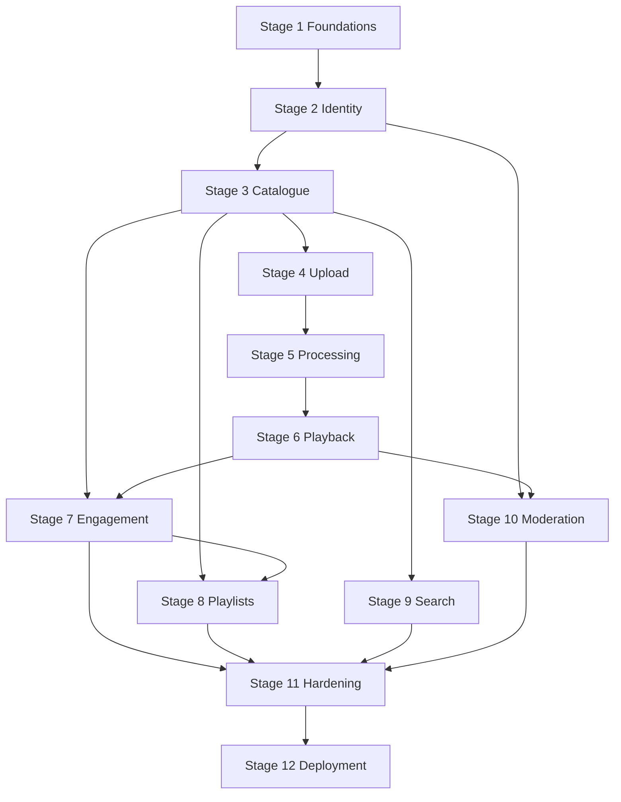

# Development Plan

**Status: plan only. No stage below has been started.**

This plan sequences the work so each stage leaves a runnable system. Later stages depend on earlier ones. Frontend work is part of the stage that introduces the feature, not a single stage at the end.

The repository today contains these design documents and no application code, no Compose file, and no deployment script.

## 1. Dependency graph

Engagement can be built against metadata before playback exists, but the view-count rule needs a real player, so stage 7 finishes after stage 6. Playlists need catalogue and the visibility rules from engagement's ACL helpers, which land in stage 3. Search needs catalogue rows and can proceed in parallel with playlists after stage 3. Moderation needs identity roles and a real video ACL, and it should land after playback so moderators can watch reported videos. Hardening is last before the Ubuntu one-command work is called done. Foundations through processing should not wait for the final deploy script; a developer Compose file exists from stage 1.

## 2. Testing strategy

Tests are part of each stage's definition of done. A stage that adds a behavior without a test for that behavior is not done.

| Layer | Tool | What it proves |
| --- | --- | --- |
| Domain and service unit tests | Pytest | Transitions, quota arithmetic, ACL decisions, retry classification, with a fake clock and a fake object store |
| API integration | Pytest + HTTPX against the FastAPI app, real PostgreSQL | Auth, validation, status codes, transactions, migrations |
| Migration | Pytest on an empty database | `alembic upgrade head` succeeds and the audit trigger rejects update and delete |
| Worker | Pytest with a one-second generated media file and real FFmpeg | Probe, thumbnail, HLS playlist exists, retry on a forced storage error, fatal path on a text file |
| Frontend unit | Vitest + Testing Library | Components render loading, empty, and error states. API client attaches the bearer token and does not read it from `localStorage` |
| End to end | Playwright against Compose | Register, upload a tiny fixture, wait until ready, play, comment, like, search, report, hide |
| Security | Pytest integration, listed in [SECURITY_DESIGN.md](SECURITY_DESIGN.md) | Private access, roles, logout epoch, upload ownership |

Database for integration tests is PostgreSQL, not SQLite. The queries use PostgreSQL features (`SKIP LOCKED`, partial indexes, `tsvector`, `citext`).

CI, when a git remote exists, runs unit tests, integration tests, and the migration test on every change. The Playwright suite and the FFmpeg suite run on the same pipeline on main, and locally via `docker compose -f compose.test.yml run tests`. Until a remote exists, that Compose command is the verification path. CI configuration is delivered in stage 11, not before the tests exist.

Frontend tests do not require the full backend. End-to-end tests do.

Coverage targets are guides, not a gate that encourages meaningless tests: services that decide visibility, quota, and job transitions should be covered on every branch. Generated OpenAPI models do not need a coverage number.

## 3. Deployment strategy

Two Compose entry points:

| File | When |
| --- | --- |
| `compose.yaml` | Developer loop. Same services as production. Bind mounts for source are allowed here only |
| `deploy/compose.prod.yaml` | Built images, no source mounts, restart policies, health checks, named volumes |

Stage 1 creates `compose.yaml` so developers can run the stack. Stage 12 creates `deploy/ubuntu-up.sh` and the production Compose file. The script:

1. Checks it is running on Ubuntu 22.04 or 24.04.
2. Installs Docker Engine and the Compose plugin when they are missing, from Docker's official package repository.
3. Creates `/opt/youtube-clone/.env` with mode 600 if it does not exist, generating `JWT_SECRET`, database password, and MinIO credentials.
4. Refuses to continue in TLS mode unless `PUBLIC_DOMAIN` is set. Without it, starts demo HTTP mode and prints that cookies are not `Secure`.
5. Builds and starts the production Compose file.
6. Waits for `/health/ready`.
7. Prints the URL, the bootstrap admin email, and where the generated password was written.

The API container applies Alembic migrations before it listens, under a PostgreSQL advisory lock.

Backups in stage 12:

- `deploy/backup.sh` runs `pg_dump -Fc` and records the MinIO volume path.
- A sample cron line is printed, daily at 02:15 UTC.
- Retention is 14 daily dumps, unless the operator changes it.
- `deploy/restore.md` describes the manual restore. Restore is not a one-command destructive action.

The one-command claim applies to install and start. It does not apply to restore.

## 4. Stages

### Stage 1 — Foundations

**Depends on:** nothing.

**Build:**

- Backend package layout from [SYSTEM_ARCHITECTURE.md](SYSTEM_ARCHITECTURE.md): app factory, config, JSON logging, request id, error handler, health routes.
- SQLAlchemy 2 engine and session dependency. No domain tables yet beyond a migration that enables `citext` and `pg_trgm`.
- Alembic configured.
- Redis and MinIO clients that the health check uses.
- Developer Compose file with Caddy, API, worker (a heartbeat loop only), PostgreSQL, Redis, MinIO.
- Frontend Vite app with the app shell, router, and an API client that reads the base URL from the environment. One home page that calls `/health/ready` is enough.
- `.env.example` with every variable in the architecture document, values empty or local-only.
- `.gitignore` that excludes `.env`.

**Definition of done:**

- `docker compose up` from a clean checkout brings up health endpoints. `/health/live` is 200. `/health/ready` is 200 only when Postgres, Redis, MinIO, and the worker heartbeat are up.
- `/docs` shows the health routes.
- Logs are JSON and include `request_id`.
- The migration test runs `upgrade head` on an empty database.
- No video or user features are pretended to exist.

### Stage 2 — Identity and channels

**Depends on:** stage 1.

**Build:**

- Tables: `users` (including `session_epoch`), `refresh_tokens`, `channels`, `user_storage_quotas`.
- Register, login, refresh, logout, me.
- Argon2id, JWT, refresh rotation, family reuse detection, epoch increment on logout.
- Bootstrap admin command, run by the API entrypoint, that creates an admin only when none exists.
- Channel read and update of name and description. Avatar upload can wait for the image helper in stage 4; the profile fields do not.
- Frontend: register, login, logout, session restore on reload via the refresh cookie, auth context in memory.

**Definition of done:**

- Integration tests cover register, duplicate email, duplicate handle, login failure, refresh rotation, reuse revocation, logout rejecting the old access token, and a deactivated user.
- A client cannot set `role` on register. The test sends `role: ADMIN` and the stored role is `USER`.
- Bootstrap does not reset an existing admin.
- The access token is not written to `localStorage`. A frontend unit test reads the client module and asserts the storage key is unused. The stricter check is a code review of the auth context plus that test.

### Stage 3 — Catalogue and ACL

**Depends on:** stage 2.

**Build:**

- Tables: `videos`, `video_tags`, `video_access_grants`.
- Create and edit metadata, soft delete, feed, video detail, related videos, channel video list, grant add and revoke.
- ACL helper used by every video read. This helper is the one later stages must call.
- Default visibility `private`.
- Frontend: home feed with loading, empty, and error states; video page without a player yet; studio list; grant editor; visibility control.

**Definition of done:**

- Feed query uses the partial index, confirmed with `EXPLAIN` in the test notes or a SQL assertion on the plan containing the index name.
- Strangers receive 404 for private videos. Grantees receive 200. Revocation returns the stranger behavior.
- Unlisted videos are absent from the feed, related list, and public channel list, and present by id.
- Changing visibility bumps `acl_version` and does not delete grants.
- Cursor pagination does not skip or duplicate rows when a new video is inserted between pages. The test inserts a row with a published date between two pages and shows the cursor is stable.

### Stage 4 — Upload

**Depends on:** stage 3.

**Build:**

- `upload_sessions`, quota reservation, multipart init, part presign, complete, abort.
- Sweeper for expired sessions and `completing` repairs. The worker process starts running sweepers in this stage.
- Thumbnail and avatar re-encode.
- Frontend upload screen: file picker, title and description, progress from completed parts, status text.
- MinIO CORS and the public S3 host on Caddy.

**Definition of done:**

- A browser integration or an API test using the MinIO SDK uploads a small file through presigned part URLs and reaches `uploaded` with one queued job. The job is not executed until stage 5, so the test asserts the job row and then cancels it.
- Quota reservation prevents two concurrent inits from exceeding the limit. The test uses two sessions and a limit that allows only one.
- Abort and expiry release `bytes_reserved`.
- Completing the same upload twice does not create two jobs.
- A thumbnail that is not an image is rejected, and a valid PNG is stored as JPEG without EXIF.
- API logs for this test do not contain the presigned query string. The test scans captured logs.

### Stage 5 — Processing

**Depends on:** stage 4.

**Build:**

- `video_processing_jobs`, claim loop, ffprobe, thumbnail extraction, HLS renditions, finalize, retry classification, stale-lock sweep, manual retry endpoint.
- Worker image with FFmpeg. API image without FFmpeg.
- Frontend processing status and retry button.

**Definition of done:**

- A generated two-second color video becomes `ready` with a master playlist, at least one variant, segments, and an auto thumbnail.
- A text file renamed to `.mp4` becomes `failed` with `invalid_media` and is not retried automatically.
- Killing the worker during a job and starting it again finishes the video exactly once. The test uses a stale `locked_until` rather than a real kill if the kill is flaky, and one separate test actually stops the container.
- Output keys are identical across a forced retry.
- The sixth attempt is refused.
- Scratch files are gone after success and after failure.

### Stage 6 — Playback

**Depends on:** stage 5.

**Build:**

- `playback_sessions`, playback endpoint, playlist routes, segment redirect, thumbnail redirect rules from [API_DESIGN.md](API_DESIGN.md).
- Watch page player using `hls.js`, and native HLS when the browser requires it.
- Logout revokes playback sessions.

**Definition of done:**

- Playwright or a scripted player loads the master playlist, a variant, and at least one segment redirect whose `Location` host is the configured S3 host.
- A private video returns 404 on playback and on the segment route for a stranger.
- After hide, the next segment request fails even if the playback cookie still exists.
- After revoke, the grantee's next segment request fails.
- Public, unlisted, owner, and grantee paths are each tested.
- iOS Safari, if a device or BrowserStack-equivalent is not available, is recorded as **not verified**. The fallback in [VIDEO_PIPELINE.md](VIDEO_PIPELINE.md) is not enabled on the basis of a guess. The stage notes say what was verified: desktop Chromium at minimum, plus Firefox if Playwright can run it.

### Stage 7 — Engagement

**Depends on:** stages 3 and 6.

**Build:**

- Reactions, comments, replies, subscriptions, view dedupe.
- Frontend controls on the watch page and channel page.
- View ping from the player after playback starts, not from the metadata load.

**Definition of done:**

- Switching like to dislike adjusts both counters in one transaction. A concurrent pair of reactions cannot drive a counter negative. The test uses two transactions and the SQL constraints.
- A stranger cannot comment on a private video.
- One reply level only. A reply to a reply is 400.
- Subscription count matches the number of rows after a sequence of subscribe and unsubscribe, including a duplicate subscribe.
- The same user does not increment views twice inside six hours. An anonymous key changes when the daily salt changes. The test sets the clock.
- Self-subscribe is rejected.

### Stage 8 — Playlists

**Depends on:** stages 3 and 7.

**Build:**

- `playlists`, `playlist_items`, CRUD, channel playlist list.
- Frontend playlist page and "save to playlist" on the watch page.

**Definition of done:**

- A private playlist is 404 to a stranger.
- A public playlist omits private videos the viewer cannot watch.
- Adding a video the user cannot watch is 404.
- Deleting a playlist does not delete videos.
- Positions remain unique under two inserts.

### Stage 9 — Search

**Depends on:** stage 3. Can be scheduled beside stages 7 and 8.

**Build:**

- Query endpoints, `simple` text search, trigram on channel name and handle, sorts, cursors.
- Frontend search page with sort control and empty state.

**Definition of done:**

- A public video is findable by a word in the title. A private or unlisted video is not.
- A hidden video is not.
- Channel search finds a handle prefix.
- `sort=views` and `sort=newest` change order in a fixture of three videos.
- Pagination cursor is stable.

### Stage 10 — Moderation

**Depends on:** stages 2 and 6. Reports can be filed once stage 3 exists, so the report table may be migrated in this stage only.

**Build:**

- `video_reports`, `moderation_actions` with the append-only trigger.
- Report, queue, dismiss, hide, restore, history, moderation playback, role change, deactivation.
- Frontend moderation pages, visible in the shell only when `/auth/me` says the role allows it. The API still enforces the role.

**Definition of done:**

- The security tests for roles, self-promotion, last-admin protection, and the audit trigger pass.
- Hide removes the video from feed, search, and anonymous playback, and writes one audit row. A second hide does not write another.
- A moderator can play a reported private video, and that play writes `view_private_video`.
- A moderator cannot play a private video that was never reported and is not hidden.
- A normal user receives 403 on moderation routes.
- Deactivation increments epoch and stops refresh.

### Stage 11 — Hardening

**Depends on:** stages 7 through 10.

**Build:**

- Rate limits from [SECURITY_DESIGN.md](SECURITY_DESIGN.md).
- Security headers and CSP on Caddy.
- Request size limits.
- The remaining security tests.
- Playwright path: register, upload fixture, wait for ready, comment, like, search, report, moderator hide.
- Frontend pass for loading, empty, and error on every route built so far.
- Responsive check at 375 px and 1280 px widths for home, watch, upload, and channel.
- CI config that runs the automated suites.

**Definition of done:**

- The security test list in the security document is checked off in the test run, not by inspection.
- Rate-limit tests assert 429 and `Retry-After` on login and upload initiate.
- A ready dependency failure (Redis stopped) makes upload initiate return 503 rather than succeed without a limit.
- Playwright completes the path above against Compose.
- No known critical defect in ACL, quota, or job duplication remains open.

### Stage 12 — Single-command deployment

**Depends on:** stage 11.

**Build:**

- `deploy/ubuntu-up.sh`, `deploy/compose.prod.yaml`, `deploy/backup.sh`, `deploy/restore.md`.
- Production images run as non-root.
- A fresh Ubuntu VM rehearsal: one command, then the Playwright smoke path against that host, or a documented subset if browsers are not installed on the server (run Playwright from the operator laptop against the host).

**Definition of done:**

- A clean Ubuntu machine with only the repository and a domain, or explicitly in demo mode, reaches `/health/ready` after one script invocation.
- The script is safe to re-run: it does not rotate existing secrets and does not create a second admin.
- Backup script produces a restorable `pg_dump`. One restore rehearsal is recorded.
- Swagger is reachable at `/docs`.
- MinIO console and database ports are not reachable from the public interface. The rehearsal checks this with a port scan of the host's public address.

## 5. Recommended implementation sequence

The graph's critical path is the one to staff first:

1. Foundations
2. Identity
3. Catalogue and ACL
4. Upload
5. Processing
6. Playback
7. Engagement
8. Moderation
9. Playlists and search, in either order, search first if a second person is free during engagement
10. Hardening
11. Deployment rehearsal

Moderation is before playlists in this staffing order because privacy and audit are higher risk than playlists. The dependency graph still allows playlists earlier.

Do not start stage 4 before the ACL helper exists. Upload bugs are much harder to unwind if private drafts can leak through an unfinished feed.

## 6. Exit criteria for the whole first release

The release matches this design when:

- every in-scope requirement in [PROJECT_OVERVIEW.md](PROJECT_OVERVIEW.md) has a passing test or an explicitly recorded verification note
- out-of-scope items are still absent
- `bash deploy/ubuntu-up.sh` on clean Ubuntu is the deploy path that was rehearsed
- the open confirmations in [ARCHITECTURAL_DECISIONS.md](ARCHITECTURAL_DECISIONS.md) are either accepted or the documents have been updated

Until those are true, the system is not implemented, regardless of how much of the plan has been written.
