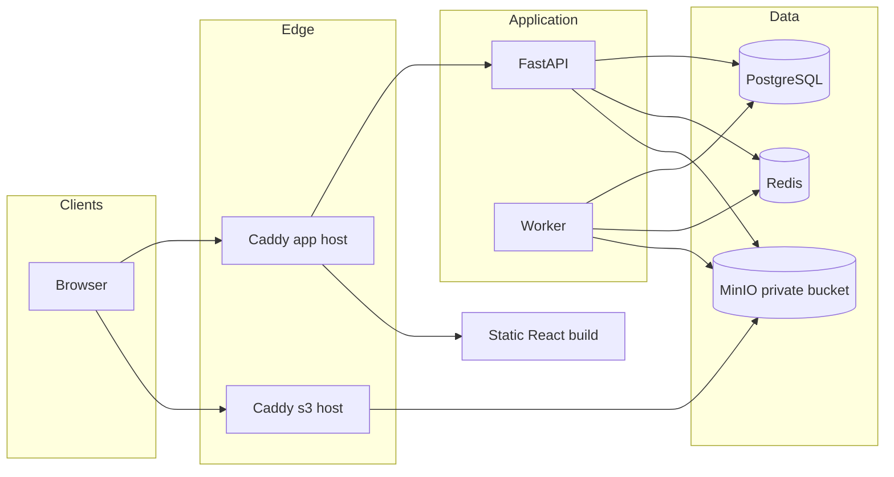
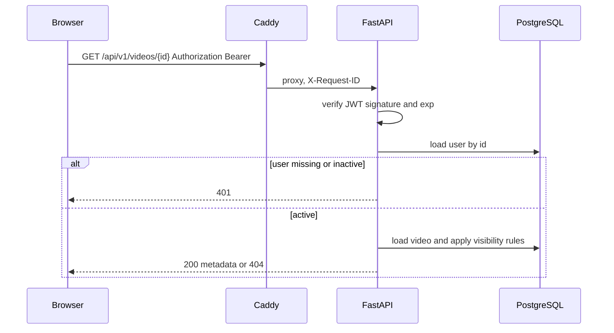
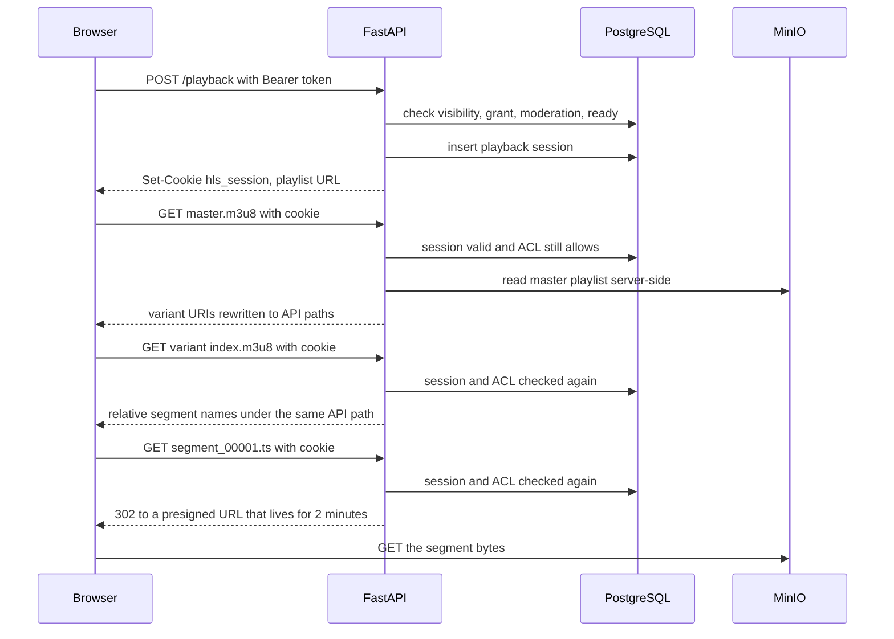

# System Architecture

**Status: design only. Nothing in this document is implemented.**

This document describes the runtime shape of the platform, how a request moves through it, and why each major technology is here.

Decisions are canonical in [ARCHITECTURAL_DECISIONS.md](ARCHITECTURAL_DECISIONS.md). Data details are in [DATABASE_DESIGN.md](DATABASE_DESIGN.md). Media details are in [VIDEO_PIPELINE.md](VIDEO_PIPELINE.md).

## 1. Architecture style

The system is a **modular monolith** plus one worker process and one object-storage service.

- One FastAPI codebase owns HTTP, business rules, and database access.
- One worker process, built from the same codebase, runs FFmpeg and storage maintenance.
- PostgreSQL is the source of truth for users, catalogue data, and processing jobs.
- Redis is a small set of ephemeral counters and heartbeats, not a second source of truth.
- MinIO stores bytes. The database stores object keys and status.
- Caddy terminates TLS, serves the static frontend, proxies the API, and proxies the S3 API on a separate host name.

Microservices were rejected for the first release. A single server does not benefit from network hops between "user service", "video service", and "comment service". Module boundaries inside one process give separation without distributed failure modes. See ADR-001.



## 2. Component responsibilities

### 2.1 Browser

- Renders the React application.
- Holds the access token in memory only.
- Sends `Authorization: Bearer` on API calls.
- Sends cookies on refresh and on HLS playlist requests.
- Uploads video parts with HTTP PUT to presigned URLs on the S3 host.
- Plays HLS with `hls.js`, or native HLS on Safari, using a path-scoped cookie.

The browser is not trusted to decide visibility, role, or quota.

### 2.2 Edge proxy (Caddy)

Two sites:

| Site | Routes |
| --- | --- |
| `https://<domain>` | `/` static files, `/api/*` to FastAPI, `/docs` and `/redoc` and `/openapi.json` to FastAPI, `/health/*` to FastAPI |
| `https://s3.<domain>` | Reverse proxy to MinIO port 9000, preserving the `Host` header used to sign presigned URLs |

The MinIO console port is not published.

Caddy also sets security headers (ADR-014). Demo mode without DNS listens on port 80 and does not mark cookies `Secure`.

### 2.3 FastAPI application

Process model: Uvicorn with two workers, run as a non-root user. The API image does not include FFmpeg.

Internal layout:

```text
backend/app/
  main.py                 # app factory, routers, exception handlers
  api/v1/                 # HTTP adapters, one module per area
  core/                   # config, logging, security helpers, error types
  domain/                 # pure rules that do not import FastAPI
  services/               # use cases and transactions
  repositories/           # SQLAlchemy queries
  db/                     # engine, session, base
  integrations/           # MinIO, Redis, clock
  workers/                # claim loop, ffmpeg, sweepers (worker image only)
```

Dependency direction:

```text
api → services → repositories → database
api → services → integrations
workers → services
```

Routers do not contain business rules and do not call MinIO or Redis directly. Services do not import `fastapi`. Repositories do not commit; the service owns the transaction boundary. This is the standard the implementation must follow. Extra layers such as generic unit-of-work frameworks are intentionally absent (ADR-026).

Modules:

| Module | Responsibility |
| --- | --- |
| identity | Registration, login, refresh, logout, user active flag |
| channels | Profile, subscriptions |
| catalogue | Video metadata, feed, related videos, tags |
| uploads | Multipart sessions, quota reservation, thumbnail ingest |
| processing | Job creation, status queries, retry requests |
| playback | Playback sessions, playlist authorization, URL rewriting |
| engagement | Reactions, comments, view dedupe |
| playlists | Playlist CRUD and membership |
| search | Full-text queries |
| moderation | Reports, hide, restore, role changes, audit writes |
| health | Liveness and readiness |

### 2.4 Worker

A separate container of the worker image (FFmpeg installed), command equivalent to `python -m app.workers`.

Two loops in one process:

1. **Job loop.** Claim one processing job with `FOR UPDATE SKIP LOCKED`, run probe, thumbnail, transcode, upload, and finalize. Concurrency defaults to 1.
2. **Sweeper loop.** Every 60 seconds: expire upload sessions, repair missing jobs, release stale locks, delete objects for soft-deleted videos, purge expired playback sessions and view-dedupe rows, refresh the worker heartbeat.

One process is enough on one server. A second OS process would only add contention for CPU and disk. If transcode concurrency is later raised above 1, the claim query already supports multiple workers.

The worker is synchronous. FFmpeg is a blocking subprocess. An async worker would not make transcoding faster (ADR-016).

### 2.5 PostgreSQL

Stores all durable application state, including:

- identity, channels, grants, engagement, moderation audit
- video metadata and processing status
- upload sessions
- processing jobs
- playback sessions

Jobs live here so that "the original is stored" and "a job exists" commit together, and so a Redis restart cannot drop the queue (ADR-002).

### 2.6 Redis

Used only for:

- rate-limit counters
- worker heartbeat key `worker:heartbeat` with a 90 second TTL
- optional short-lived lock around bootstrap admin creation

Redis is not used for sessions, job queues, or feed caches. Losing Redis must not lose users, videos, or jobs. It does stop new logins that are rate limited and makes readiness fail, because abuse protection would otherwise silently disappear (ADR-022, ADR-024).

### 2.7 MinIO

One private bucket, default name `media`. Layout:

```text
originals/{video_id}/source
hls/{video_id}/master.m3u8
hls/{video_id}/{height}/index.m3u8
hls/{video_id}/{height}/segment_{n}.ts
thumbnails/{video_id}/auto.jpg
thumbnails/{video_id}/custom.jpg
avatars/{channel_id}.jpg
```

Keys are deterministic so a retried job overwrites the same objects. No public bucket policy. No anonymous `GetObject`. Browser access is either a presigned URL or an API response. See [VIDEO_PIPELINE.md](VIDEO_PIPELINE.md).

### 2.8 Frontend

React, TypeScript, and Vite. Static build served by Caddy.

| Concern | Choice |
| --- | --- |
| Routing | React Router |
| Server state | TanStack Query |
| Auth state | In-memory access token plus a small auth context. Refresh on load via the refresh cookie |
| Styling | Tailwind, YouTube-like spacing, dark surface, red primary action |
| Player | `hls.js`, with Safari using the native video element when `canPlayType` accepts `application/vnd.apple.mpegurl` |

Major screens: home, watch, channel, search, upload, my videos, playlist, login, register, channel settings, moderation queue.

Shared components: app shell, video card, video grid, player, comment thread, tag input, upload progress, empty state, error state, loading skeleton, pagination sentinel.

The frontend talks only to `/api/v1` on the same site, plus presigned URLs returned by the API.

## 3. Request lifecycles

### 3.1 Authenticated API call



Authorization data comes from PostgreSQL on every authenticated request. The JWT proves identity and carries `epoch`. The API rejects the token when `epoch` does not match `users.session_epoch`, when the user is missing, or when the user is inactive. Role changes, logout, and deactivation apply on the next request (ADR-005).

### 3.2 Anonymous read

Feed, public watch metadata, public channel, and search do not require a token. Private videos are indistinguishable from missing videos for callers without access: the response is 404 (ADR-011).

### 3.3 Upload

Described in full in [VIDEO_PIPELINE.md](VIDEO_PIPELINE.md). Summary:

1. `POST /api/v1/videos` creates a draft row.
2. `POST /api/v1/videos/{id}/upload` reserves quota and starts a multipart upload.
3. The browser PUTs parts to `s3.<domain>` using presigned URLs.
4. `POST .../upload/complete` finishes the multipart upload, then in one database transaction marks the video `uploaded` and inserts a processing job.
5. The worker claims the job and writes HLS and thumbnails.
6. The video becomes `ready` and, if public and visible, appears in the feed.

### 3.4 Playback



Playlist and segment routes re-check access. The presigned URL is minted only when the player asks for that segment, so a one-hour video does not depend on URLs created at the start. A hide, revoke, or visibility change fails the next segment request. The two-minute object URL is only a transfer ticket for a request that already passed the check (ADR-004).

### 3.5 Moderation hide

In one transaction the service sets `moderation_status = hidden`, increments `acl_version`, updates open reports to `action_taken` when the action came from a report, and inserts a `moderation_actions` row. The next playlist or segment request fails the ACL check. A segment download that has already started can finish.

## 4. Data flow and consistency

There is no distributed transaction across PostgreSQL and MinIO. The design uses a **database outbox in the same row family** plus a sweeper.

| Step | Durable state if the process crashes |
| --- | --- |
| After draft insert | Video `draft`. No objects |
| After multipart start | Upload session `initiated`, quota reserved, MinIO upload id stored. Part URLs are signed for an exact `Content-Length` |
| After parts uploaded, before complete | MinIO holds only parts whose size matched the signature. Sweeper aborts the session after `expires_at` |
| After MinIO complete, before DB commit | Session left in `completing`. Sweeper sees the object and finishes the DB transition |
| After DB commit | Video `uploaded`, one queued job |
| During transcode | Job `running` with `locked_until`. Stale lock returns the job to `queued` |
| After artifact upload, before finalize | Objects may exist. Retry overwrites the same keys, then commits `ready` |
| After finalize | Video `ready`. Local scratch deleted |

Object deletion is also asynchronous. Soft-deleting a video commits `deleted_at` and a cleanup flag. The sweeper deletes keys and is safe to run twice.

The accepted inconsistency window is one sweeper interval for metadata repair, and one in-flight segment for playback. After a hide or revoke, the next segment request fails. A download that already started can finish. That window is documented in [SECURITY_DESIGN.md](SECURITY_DESIGN.md) and ADR-004.

## 5. Configuration

Environment variables are the only configuration channel. A `.env` file is generated by the Ubuntu setup script and is not committed.

| Variable | Purpose |
| --- | --- |
| `DATABASE_URL` | SQLAlchemy URL |
| `REDIS_URL` | Redis URL |
| `MINIO_ENDPOINT` | Internal `minio:9000`. API and worker only |
| `S3_PUBLIC_BASE_URL` | `https://s3.<domain>` used only to presign |
| `MINIO_DOMAIN` | `s3.<domain>`, given to the MinIO process |
| `MINIO_ACCESS_KEY` / `MINIO_SECRET_KEY` | `media-app` credentials. API and worker only |
| `MINIO_ROOT_USER` / `MINIO_ROOT_PASSWORD` | MinIO process and `minio-init` only. Not in the API environment |
| `MINIO_BUCKET` | Default `media` |
| `MINIO_BUCKET_QUOTA_BYTES` | Hard bucket cap set by init |
| `PART_SIZE_BYTES` | `16777216` |
| `MAX_PARTS` | `512` |
| `UPLOAD_PART_URL_TTL_SECONDS` | Default 1200 |
| `JWT_SECRET` | HMAC secret, at least 32 bytes |
| `ACCESS_TOKEN_TTL_SECONDS` | Default 900 |
| `REFRESH_TOKEN_TTL_SECONDS` | Default 1209600 |
| `PUBLIC_APP_URL` | Public origin for CORS and cookie security |
| `COOKIE_SECURE` | `true` except HTTP demo mode |
| `CORS_ORIGINS` | Exact frontend origin |
| `BOOTSTRAP_ADMIN_EMAIL` / `BOOTSTRAP_ADMIN_PASSWORD` | First admin, used once |
| `MAX_UPLOAD_BYTES` | Default 2147483648 |
| `MAX_DURATION_SECONDS` | Default 3600 |
| `DEFAULT_QUOTA_BYTES` | Default 10737418240 |
| `MAX_ACTIVE_UPLOADS` | Default 2 |
| `FFMPEG_CONCURRENCY` | Default 1 |
| `WORK_DIR` | Transcode scratch, on a large volume |
| `PLAYBACK_SEGMENT_TTL_SECONDS` | Default 120. Lifetime of the object-storage URL minted after an authorized segment request |

## 6. Logging, errors, and health

### Logging

- JSON to stdout: `timestamp`, `level`, `logger`, `message`, `request_id`, `user_id` when known.
- Caddy generates `X-Request-ID` if the client did not send one, and the API echoes it.
- Passwords, refresh tokens, playback cookies, and full presigned URLs are never logged. Object keys may be logged.
- The worker logs `job_id`, `video_id`, `attempt`, and FFmpeg's exit code. FFmpeg stderr is truncated and stored on the job row.

### Errors

Domain code raises typed errors (`NotFound`, `PermissionDenied`, `Conflict`, `Validation`, `RateLimited`, `UpstreamUnavailable`). One exception handler writes:

```json
{
  "error": {
    "code": "VIDEO_NOT_FOUND",
    "message": "Video not found.",
    "details": [],
    "request_id": "..."
  }
}
```

Uncaught exceptions become `INTERNAL_ERROR` with a 500 and a server-side stack trace. The client never receives the stack trace.

`PermissionDenied` for private-video existence is converted to `NotFound` at the catalogue boundary so the HTTP result is 404. Moderators use moderation routes, which may return 403.

### Health

| Path | Behavior |
| --- | --- |
| `GET /health/live` | 200 if the process can serve. No dependency checks |
| `GET /health/ready` | 200 only if PostgreSQL answers `SELECT 1`, Redis answers `PING`, the application credentials can see the bucket, and `worker:heartbeat` is newer than 2 minutes. The bucket-policy match and the absence of root credentials are startup checks, not part of every ready probe |

Compose uses liveness to restart a stuck API process and readiness to order startup. The setup script blocks until ready.

## 7. Deployment topology

Compose services, in start order:

| Order | Service | Role | Published port |
| --- | --- | --- | --- |
| 1 | `postgres` | PostgreSQL 16. Healthcheck `pg_isready` | none |
| 1 | `redis` | Redis 7, AOF on. Healthcheck `PING` | none |
| 1 | `minio` | MinIO. `MINIO_BROWSER=off`. Healthcheck is a TCP check on 9000 inside the network | none |
| 2 | `minio-init` | One-shot. Creates the bucket, `media-app`, policy, CORS, lifecycle, and bucket quota. Exits 0 on repeat | none |
| 3 | `api` | Migrates, then serves. Depends on postgres healthy, redis healthy, and `minio-init` completed | none |
| 4 | `worker` | Heartbeat, sweepers, and transcode. Depends on `api` healthy so the schema exists | none |
| 5 | `edge` | Caddy plus the static build. Depends on `api` healthy | 80, 443 |

Volumes: `pg_data`, `redis_data`, `minio_data`, `work_data`. `work_data` holds transcode scratch and may be recreated. The other three may not.

The API container runs Alembic `upgrade head` before binding the port, under a PostgreSQL advisory lock. Each revision runs in a transaction. A failed revision rolls back and the process exits non-zero without listening. Compose may restart it. The deploy script does not treat a restart loop as success, and it does not run `downgrade`.

`bash deploy/ubuntu-up.sh` is the only install path. The script does not exist yet. Its required behavior is specified in [DEVELOPMENT_PLAN.md](DEVELOPMENT_PLAN.md). In short: check Ubuntu, Docker, disk, and environment; refuse to delete or recreate persistent volumes on a repeat run; start in the order above; require `/health/ready` 200; print `deploy: FAIL <code>` and exit non-zero on any failed check. Re-running the script does not rotate secrets and does not create a second admin.

### Backups

`deploy/backup.sh` (later stage) writes a `pg_dump` custom-format archive and an `mc mirror` of bucket `media` using the `media-app` credentials. It then runs `pg_restore -l` and fails the backup if the archive has no table of contents. Restore is a documented manual procedure in `deploy/restore.md`: stop the API and worker, restore the database, restore the mirror into the bucket, start, run the sweeper once. The install script does not restore, and it never deletes volumes as part of a failed deploy. One restore rehearsal is part of stage 12. Backup automation beyond the script and a cron example is out of scope.

## 8. Technology decisions

| Technology | Role | Why it is here |
| --- | --- | --- |
| Python 3.12 | API and worker | Required. One language for HTTP and FFmpeg orchestration |
| FastAPI | HTTP | Required. OpenAPI and `/docs` come from the framework |
| Pydantic v2 | Schemas | Required. Validates input and documents the schema |
| SQLAlchemy 2.x | Persistence | Required. Explicit queries, 2.0 style |
| Alembic | Migrations | Required. Versioned schema |
| PostgreSQL 16 | System of record and job queue | Required. Constraints, FTS, `SKIP LOCKED` |
| Redis 7 | Rate limits and heartbeat | Required. Isolated from durable state |
| MinIO | S3-compatible bytes | Required. Private bucket, presigned multipart |
| FFmpeg | Probe, thumbnail, HLS | Required. Industry default, scriptable |
| Caddy | TLS and routing | One binary obtains certificates when a domain is set |
| React + Vite + TypeScript | UI | Required. Static build fits a single host |
| hls.js | Playback | Required to play MPEG-TS HLS in Chromium browsers |
| Pytest, Vitest, Playwright | Tests | Match the quality requirements without a custom harness |
| Docker Compose | Runtime | Required. One command brings up the full stack |

Alternatives that were considered and rejected are recorded as ADRs, not repeated here.

## 9. Scaling path that this design does not build

If one server is no longer enough, the split order is:

1. Move MinIO to a larger disk or a managed S3 endpoint. Keys and presign flow stay the same.
2. Run extra workers against the same job table.
3. Put a CDN in front of public segment URLs. Private videos stay on presigned URLs.
4. Add PostgreSQL backups and, only with evidence of read pressure, a replica for search.
5. Split services only if a team boundary requires it. The job table and catalogue schema do not assume a split.

None of these steps are part of the first release.
