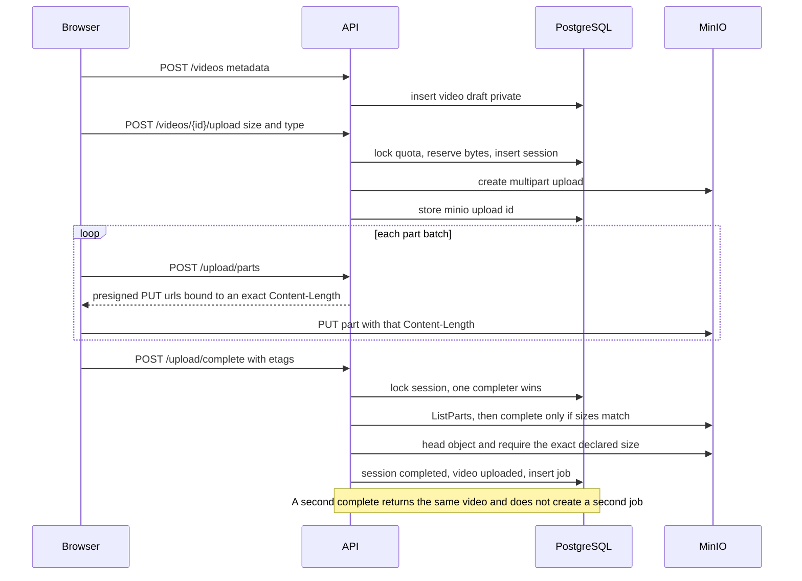
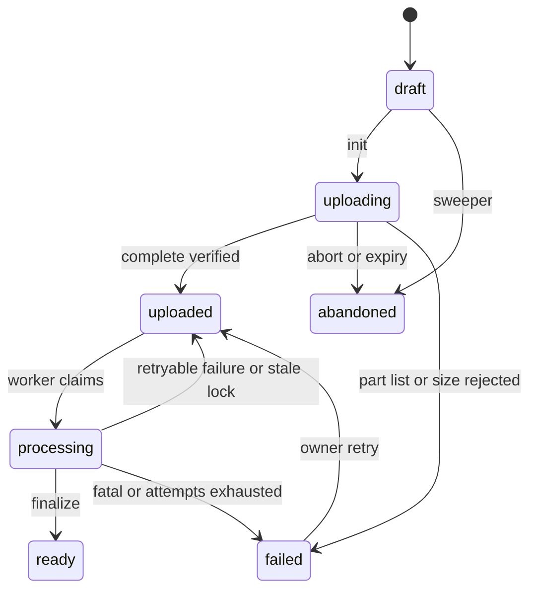

# Video Pipeline

**Status: design only. Nothing in this document is implemented.**

This document specifies how a video moves from a file on the user's machine to an HLS stream, how failures are recovered, and how private bytes stay private.

Related decisions: ADR-002, ADR-003, ADR-004, ADR-008, ADR-013, ADR-019, ADR-023, ADR-025, ADR-031, ADR-032.

## 1. Goals and non-goals

Goals:

- The API process does not carry video bytes.
- A crash during upload or transcode can be retried without creating a second active job or a second object key.
- Viewers can play a `ready` video only if the visibility rules allow it.
- Processing is limited so one upload cannot fill the disk or pin the CPU forever.

Non-goals for the first release:

- Resume across more than 24 hours.
- Per-title encoding ladders, AV1, VP9, or GPU encode.
- Replacing the original after it has been stored.
- A CDN.

## 2. Storage layout

One MinIO bucket, `media`, private. No anonymous policy.

```text
originals/{video_id}/source
hls/{video_id}/master.m3u8
hls/{video_id}/360/index.m3u8
hls/{video_id}/360/segment_00001.ts
hls/{video_id}/720/index.m3u8
hls/{video_id}/720/segment_00001.ts
hls/{video_id}/1080/index.m3u8
thumbnails/{video_id}/auto.jpg
thumbnails/{video_id}/custom.jpg
avatars/{channel_id}.jpg
```

`{video_id}` and `{channel_id}` are UUIDs. The original keeps no client filename. Client filenames are displayed from nowhere persistent; only the object key is stored. This avoids path traversal and unexpected content types in the key.

Deterministic keys make retries idempotent: uploading `hls/{video_id}/720/index.m3u8` again replaces the previous object.

Bucket lifecycle rule, as a backstop behind the sweeper:

- abort incomplete multipart uploads after 1 day

The deploy init also sets a hard bucket quota (`MINIO_BUCKET_QUOTA_BYTES`). That cap is disk protection for the whole bucket. It is not a per-user quota. Per-user quota stays in PostgreSQL.

Object expiry of originals is not enabled. Originals are kept so a failed transcode can be retried without asking the user to upload again. The cost is disk. The quota charges the original size plus the HLS and thumbnail sizes actually stored.

## 3. Upload lifecycle



### 3.1 Create draft

`POST /api/v1/videos` validates metadata and inserts a video with `processing_status = draft` and `visibility` as requested, default `private`. No quota change yet. A draft that never starts an upload is abandoned by the sweeper after 24 hours.

### 3.2 Part geometry

These values are fixed so a presigned URL cannot grow past the reserved quota (ADR-031).

| Constant | Value |
| --- | --- |
| `PART_SIZE_BYTES` | 16 MiB (16777216). Every non-final part is this size, not "up to" this size |
| `MAX_PARTS` | 512. Startup refuses `MAX_UPLOAD_BYTES` larger than `PART_SIZE_BYTES * MAX_PARTS` (8 GiB) |
| Default `MAX_UPLOAD_BYTES` | 2 GiB, which is 128 parts |
| Part URL lifetime | 20 minutes |
| Session lifetime | 24 hours |

`part_count = ceil(byte_size / PART_SIZE_BYTES)`.

For part number `n`:

- if `n < part_count`, the signed `Content-Length` is exactly `PART_SIZE_BYTES`
- if `n = part_count`, the signed `Content-Length` is `byte_size - (part_count - 1) * PART_SIZE_BYTES`, which is from 1 byte through `PART_SIZE_BYTES`

A one-part upload may be smaller than 5 MiB. S3 allows that only for the final part. Every earlier part is 16 MiB, which is above the S3 minimum of 5 MiB.

### 3.3 Initiate multipart upload

`POST /api/v1/videos/{id}/upload` body: `byte_size`, `content_type`.

The service rejects the request unless all of the following hold:

- caller owns the video
- status is `draft`
- `byte_size` is between 1 and `MAX_UPLOAD_BYTES`
- `part_count` computed above is between 1 and `MAX_PARTS`
- `content_type` is one of `video/mp4`, `video/quicktime`, `video/webm`, `video/x-matroska`, `video/mpeg`
- the user has fewer than `MAX_ACTIVE_UPLOADS` sessions in `initiated` or `completing`
- `bytes_committed + bytes_reserved + byte_size <= bytes_limit` under `SELECT FOR UPDATE` on the quota row

On success, in one transaction, the service reserves `byte_size` and inserts an upload session with `expires_at = now() + 24 hours`, `part_size = PART_SIZE_BYTES`, `part_count`, and `minio_upload_id` null. It then creates the multipart upload on key `originals/{video_id}/source`. A second transaction stores the upload id and sets the video to `uploading`.

If create-multipart fails, the service releases the reservation, marks the session `aborted`, and returns `503 STORAGE_UNAVAILABLE`. The video returns to `draft` so the owner can try again. No job is inserted.

If the process dies after MinIO created the upload and before the upload id is stored, the id is lost. The sweeper releases that reservation after 5 minutes. A reconciliation pass aborts multipart uploads whose id is not in `upload_sessions`. The lifecycle rule is the backstop if both the API and the sweeper are down.

### 3.4 Presign parts

`POST /api/v1/videos/{id}/upload/parts` body: `part_numbers`, at most 20 numbers.

The API rejects the call with `422 UPLOAD_PART_INVALID` when:

- the session is missing, not `initiated`, expired, or not owned by the caller
- the list is empty, longer than 20, or contains duplicates
- any number is not an integer from 1 through `part_count` inclusive
- any number is greater than `MAX_PARTS`

Otherwise it returns one presigned `PUT` per number. Each URL is SigV4, path-style, bound to that object key, that upload id, that part number, and the exact `Content-Length` from section 3.2. `SignedHeaders` includes `host` and `content-length`. The response tells the client the `content_length` it must send. URLs expire after 20 minutes. Asking again for the same numbers returns new URLs for the same upload id and the same lengths.

A `PUT` with any other length fails signature validation in MinIO and stores nothing. The API does not accept a client-supplied length.

Presigning uses `S3_PUBLIC_BASE_URL`. The browser never receives `MINIO_ACCESS_KEY`, `MINIO_SECRET_KEY`, `MINIO_ROOT_USER`, or `MINIO_ROOT_PASSWORD`.

### 3.5 Complete

`POST /api/v1/videos/{id}/upload/complete` body: `parts: [{part_number, etag}]`.

The client list is a hint. `ListParts` is the authority.

1. Lock the session with `SELECT ... FOR UPDATE`.
2. If status is `completed` and the video is `uploaded`, `processing`, `ready`, or `failed` because processing failed after a good upload, return the current video. Do not call `CompleteMultipartUpload` again. The unique active-job index is the second guard.
3. If status is `aborted` or `expired`, return `409 INVALID_STATE` or `409 UPLOAD_EXPIRED`.
4. If `expires_at` has passed, return `409 UPLOAD_EXPIRED` and leave cleanup to the sweeper.
5. If status is `completing`, `completion_started_at` is within the last 2 minutes, and `completion_token` is not this request, return `409 UPLOAD_IN_PROGRESS`.
6. Otherwise set `completing`, a new `completion_token`, and `completion_started_at = now()`, then commit so the row lock is not held during MinIO calls.

After the lock is released:

7. `ListParts` for that upload id. This call uses the application credentials on the internal MinIO endpoint.
8. Reject unless the part numbers are exactly the set `1 .. part_count`, with no gaps and no extras.
9. Reject unless each part's `Size` equals the signed length for that part number, and the sum equals `expected_size` exactly. There is no percentage tolerance. A tolerance would let a caller store more bytes than the quota reservation.
10. Reject unless every client ETag matches the ETag `ListParts` returned for that part number. Compare the hex value, ignoring surrounding quotes.
11. `CompleteMultipartUpload` using the `ListParts` ETags.
12. `HEAD` the object. Reject unless `Content-Length` equals `expected_size` and the key is `originals/{video_id}/source`.

On any rejection in steps 7–12 the service aborts the multipart upload, deletes the object if `HEAD` shows it exists, and only then releases `bytes_reserved`. The session becomes `aborted`, `error_code` is `upload_rejected`, and the video becomes `failed`. Processing retry is refused because there is no valid original. The owner deletes the video and uploads again. If the abort itself fails, the reservation stays, the session stays `completing` with `error_code` set, and the sweeper retries the abort. Quota is not returned while parts may still be on disk.

On success, one transaction locks the session again, checks `completion_token`, and then:

- session `completed`, `completed_at` set
- reservation released
- `bytes_committed` increased by `expected_size` (the same number `HEAD` returned)
- video `processing_status = uploaded`, `original_object_key` and `source_byte_size` set
- one queued job inserted

If that commit fails, the object exists and the session stays `completing` with no `error_code`. The sweeper finishes the database transition. It `HEAD`s the object first and does not call `CompleteMultipartUpload` when the object is already present.

A network error before `CompleteMultipartUpload` returns the session to `initiated`, clears the token, and responds `503 STORAGE_UNAVAILABLE`. The client may retry immediately.

A network error from `CompleteMultipartUpload` is followed by `HEAD`. A matching object finishes the database transition. A missing object returns the session to `initiated` and responds `503`. If `HEAD` also fails, the session stays `completing` and the response is `503`. A retry then receives `409 UPLOAD_IN_PROGRESS` with `Retry-After: 5` until the 2 minute window passes. After that, the retry or the sweeper continues the same checks. The reservation is held through all of these paths.

### 3.6 Abort

`POST /api/v1/videos/{id}/upload/abort` takes the same session lock. It aborts the multipart upload when an upload id exists, deletes a stray object at the key, sets the session `aborted`, releases the reservation only after that abort succeeds, and sets the video `abandoned` when it was `uploading`. A second abort returns `204`.

### 3.7 Who enforces each check

| Check | API | MinIO |
| --- | --- | --- |
| Caller owns the video and the session is active | Yes | No user model |
| `byte_size` ≤ `MAX_UPLOAD_BYTES` and `part_count` ≤ `MAX_PARTS` | Yes, at initiate | No. S3's own ceiling is 10,000 parts and 5 GiB per part |
| Part numbers are unique and inside `1 .. part_count` | Yes, before any URL is signed | A URL signed for part 3 fails if it is sent as part 4, because `partNumber` is in the signature |
| Non-final part is exactly 16 MiB, final part is the exact remainder | Yes. The signature covers `Content-Length`. Complete compares `ListParts` sizes with those lengths | Yes. A different `Content-Length` fails SigV4 and MinIO stores no part. MinIO also rejects a non-final part under 5 MiB and any part over 5 GiB |
| Sum of stored parts equals `expected_size` | Yes, from `ListParts` and again from `HEAD` | No. MinIO does not know the declared size |
| Client ETags match stored parts | Yes | MinIO returns the ETags; it does not see the client's complete body as authority until the API sends it |
| Quota reservation and commit | Yes, row lock in PostgreSQL | No per-user quota |
| Duplicate complete | Yes. `completed` returns the current video. One active job per video | A second `CompleteMultipartUpload` returns `NoSuchUpload`. The API must not treat that error as success unless `HEAD` already shows the verified object |
| Concurrent complete | Yes. Row lock plus `completion_token`. The loser receives `409 UPLOAD_IN_PROGRESS` | Not used as the concurrency control |
| Expired session cannot be presigned or completed | Yes | No |
| Abandoned and expired multipart uploads are aborted | Yes, sweeper, including uploads whose id is missing from `upload_sessions` after 15 minutes | Lifecycle aborts incomplete multipart uploads after 1 day even if the sweeper is down |
| Unsigned or anonymous writes | The API never issues those URLs | Bucket policy has no allow for `Principal: "*"`. Unsigned `PUT` and `GET` are denied |
| Whole-bucket disk cap | Deploy sets it; the API does not | Hard bucket quota |

Presigned upload URLs are therefore not a blank write capability. Each URL can store one part, of one signed length, for 20 minutes. The maximum bytes a session can store is `expected_size`, which was reserved against the user quota before any URL existed.

### 3.8 Cleanup of incomplete uploads

The sweeper runs every 60 seconds.

| Condition | Action |
| --- | --- |
| Session `initiated`, `minio_upload_id` null, older than 5 minutes | Release reservation, session `aborted`, video `abandoned` if it was still `draft` |
| Session `initiated` and `expires_at` passed | Abort multipart upload, then release reservation, session `expired`, video `abandoned` |
| Session `completing`, `error_code` set | Retry abort and object delete, then release reservation, session `aborted`, video `failed` |
| Session `completing`, no `error_code`, older than 2 minutes, `HEAD` size equals `expected_size` | Finish the database completion transition if no active job exists. Do not complete the multipart upload again |
| Session `completing`, no `error_code`, older than 2 minutes, object missing | Run the same `ListParts` checks as complete. Valid parts are completed. Invalid parts are aborted |
| Video `draft` older than 24 hours | Set `abandoned` |
| Multipart upload under `originals/` whose upload id is not stored on a session, and whose MinIO `Initiated` time is older than 15 minutes | `AbortMultipartUpload` |
| Video `uploaded` with no queued or running job, and fewer than 6 historical jobs | Insert a queued job |
| Job `running` and `locked_until` passed | Set job `queued`, clear lock, set video `uploaded`, set `next_run_at = now()` |

Abort of an already-aborted upload is success. The reservation is released only after abort or after `HEAD` confirms the object is gone. Abandoned videos do not appear in any feed. Bytes are not committed.

### 3.9 Custom thumbnail

Thumbnails are small. They are posted to the API as `multipart/form-data`, maximum 2 MB, types JPEG, PNG, or WebP.

The API decodes the image with Pillow, rejects files that do not decode or exceed 1920×1080, strips metadata by re-encoding to JPEG quality 85, and stores `thumbnails/{video_id}/custom.jpg`. The custom thumbnail may be uploaded any time after the draft exists, including before processing finishes. It does not pass through the video worker.

Avatars use the same re-encode path and the key `avatars/{channel_id}.jpg`.

## 4. Processing



Job row states are `queued`, `running`, `succeeded`, `failed`, and `cancelled`. The video state and the job state are not the same column and must not be collapsed.

`failed → uploaded` is only the owner retry of a processed original. Upload verification failure does not take that edge. There is no original to process.

### 4.1 Claim

The worker, inside a transaction:

```text
SELECT id FROM video_processing_jobs
WHERE status = 'queued' AND next_run_at <= now()
ORDER BY next_run_at, created_at
FOR UPDATE SKIP LOCKED
LIMIT 1
```

It then sets `status = running`, `locked_by`, `locked_until = now() + 3 hours`, `started_at`, and sets the video to `processing`.

`SKIP LOCKED` allows a second worker later without double-processing. The partial unique index is a second guard.

The lock duration is 3 hours because the FFmpeg timeout is 3 hours. The sweeper requeues a lock that expires, which covers a killed worker.

### 4.2 Validate

Work directory: `{WORK_DIR}/{job_id}/`, created empty at the start of each attempt so a previous crash cannot leave a partial segment list that is then uploaded.

The worker downloads `originals/{video_id}/source` to `{WORK_DIR}/{job_id}/source`. Download is used instead of letting FFmpeg read a presigned URL, so FFmpeg does not need network access.

`ffprobe` must show:

- at least one video stream
- duration between 1 second and `MAX_DURATION_SECONDS`
- width and height each between 64 and 3840
- a container and codec FFmpeg can decode

Failure here is **fatal**. The job is `failed` with `failure_class = fatal`, the video is `failed`, and no automatic retry is scheduled. The original is kept so the owner can inspect the failure. Scratch is deleted.

FFmpeg is invoked with `-protocol_whitelist file,pipe` and `-nostdin`. It runs as the non-root worker user. A wall-clock timeout kills the process group: `min(3 hours, max(30 minutes, 4 × duration))`.

### 4.3 Thumbnail

Extract one frame near 10 percent of the duration, or at 1 second for very short videos. Encode to JPEG, maximum width 1280, and upload to `thumbnails/{video_id}/auto.jpg`. If a custom thumbnail already exists, the auto thumbnail is still generated and used as a fallback.

### 4.4 HLS transcode

Renditions, software x264, preset `veryfast`, pixel format `yuv420p`, AAC-LC 128 kbps stereo 48 kHz, 6 second segments, GOP closed and aligned:

| Rendition | When | Video bitrate | Max rate |
| --- | --- | --- | --- |
| 360p | source height ≥ 360, or always if the source is smaller | 800 kbps | 856 kbps |
| 720p | source height ≥ 720 | 2800 kbps | 2996 kbps |
| 1080p | source height ≥ 1080 | 5000 kbps | 5350 kbps |

If the source is below 360p, a single rendition is produced at the source height, using the 360p bitrate cap. Audio is muxed into every rendition so the master playlist stays a simple list of media playlists (ADR-019).

Segment type is MPEG-TS (`.ts`). `hls_playlist_type` is `vod`. Variant playlists use relative segment names. The master playlist uses relative variant paths such as `720/index.m3u8`.

Keyframe alignment:

```text
-sc_threshold 0
-force_key_frames expr:gte(t,n_forced*6)
-hls_time 6
-hls_flags independent_segments
```

Before upload, the worker checks that each variant playlist exists, that each referenced segment exists, and that durations are within 2 seconds of the probed duration. A mismatch is retryable.

Artifacts upload to the deterministic keys. Existing objects are overwritten.

Disk guard: before download, free space in `WORK_DIR` must be at least `3 × source size + 1 GB`. Otherwise the job fails as retryable with `error_code = insufficient_disk` and a 30 minute backoff. This still consumes an attempt.

### 4.5 Finalize

In one transaction:

- job `succeeded`, `finished_at` set, lock cleared
- video `processing_status = ready`
- `duration_seconds`, `width`, `height`, `hls_master_key`, `auto_thumbnail_key` set
- `published_at = now()` if it is null
- `bytes_committed` increased by the size of the new HLS objects and auto thumbnail, after a quota lock

If committed bytes would exceed the quota only because of the HLS expansion, finalize still succeeds and the quota row is allowed to go over the limit. The user cannot start a new upload until they delete something. Rejecting a finished transcode would waste the encode and surprise the user. The overage is visible on the quota endpoint.

If the video was soft-deleted or the job was `cancelled` while encoding, finalize does not mark it `ready`. It deletes the uploaded HLS keys it just wrote and exits. The original cleanup sweeper removes the rest.

Scratch files are deleted after a successful finalize and also in a `finally` block on failure.

### 4.6 Idempotency

An attempt is idempotent because:

- the claim query cannot hand the same job to two workers
- only one active job can exist per video
- output keys are deterministic and overwritten
- finalize sets the same columns to the same values if it is repeated
- the work directory is wiped at the start of the attempt

The worker does not try to resume mid-FFmpeg. A retry repeats probe, thumbnail, and transcode. That wastes CPU and is accepted in exchange for a simpler worker (ADR-019 limitation).

## 5. Failure and retry

| Error | Class | What the worker does |
| --- | --- | --- |
| ffprobe says there is no video stream, or duration is out of range | fatal | Job failed, video `failed`, no retry |
| Pillow or JPEG encode failure for the auto thumbnail | retryable | Backoff and retry |
| FFmpeg non-zero exit, timeout, or playlist validation failure | retryable | Backoff and retry |
| MinIO network error | retryable | Backoff and retry |
| Not enough scratch disk | retryable | 30 minute backoff |
| Video soft-deleted mid-job | cancelled | Stop, do not mark ready |
| Attempt would exceed 3 automatic tries | n/a | Job failed, video `failed` |

Backoff for retryable errors, by attempt number: 1 minute, 5 minutes, 15 minutes. The video returns to `uploaded` while it waits, and the same job row returns to `queued` with `next_run_at` set and `attempt` incremented. The lock is cleared.

After the third automatic failure the video stays `failed`. The owner may call the retry endpoint up to three more times. Each manual retry inserts a new job only if none is active, the lifetime row count is below 6, and the original object still exists. A manual retry is rate limited to 3 per video per day, which matches the lifetime cap.

`error_code` values are stable strings: `invalid_media`, `duration_exceeded`, `ffmpeg_failed`, `ffmpeg_timeout`, `storage_error`, `insufficient_disk`, `playlist_invalid`, `upload_rejected`. Upload rejection is stored on the upload session. The processing endpoint returns it when the video is `failed` and no job exists. The UI can map these to sentences. Raw FFmpeg stderr is not returned to the client; it stays on the job row for the operator.

Owner retry requires the original object. A video that failed upload verification has no original, so retry returns `409 INVALID_STATE`.

### Videos that upload and are never processed

This is a sweeper case, not a manual mystery:

- completion committed the job, but the worker was down: the job stays `queued` and runs when the worker returns
- completion saved the object and crashed before the job insert: session is `completing`, sweeper inserts the job
- worker crashed mid-transcode: lock expires, sweeper requeues
- worker marked the job failed: the owner sees `failed` and can retry while attempts remain

No uploaded video is left in `uploaded` without a job for more than one sweeper interval unless the lifetime attempt cap is already reached. In that last case the status is `failed`, not `uploaded`.

## 6. Streaming delivery

HLS bytes are not served from a public bucket, and the API does not proxy segment bodies.

Why segment URLs are not embedded in the playlist: a VOD player often reads the playlist once and requests a segment many minutes later. A 60 minute video would require those embedded URLs to live for at least an hour, which is also how long a revoke would be ignored. Instead, the playlist names segments on the API. Access is checked when the player actually requests the segment.

1. The client calls `POST /api/v1/videos/{id}/playback` with the bearer token, or without a token if the video is public or unlisted.
2. The API checks `processing_status = ready`, `deleted_at is null`, moderation, and visibility. Hidden videos are playable by the owner and by moderators on the moderation route only.
3. The API inserts a `playback_sessions` row expiring in 6 hours and sets the path-scoped `hls_session` cookie.
4. The player loads `GET /api/v1/videos/{id}/hls/master.m3u8` with that cookie. `hls.js` uses credentials. Safari native HLS sends the cookie because the URL is same-site and the cookie path matches.
5. The API loads the session, checks it is not revoked or expired, checks `video_id` matches, and re-reads the video ACL. A failed check returns 404 and revokes the session.
6. The API reads the master playlist from MinIO and rewrites variant URIs to relative API paths such as `720/index.m3u8`.
7. The variant endpoint checks the session and ACL again, reads the variant playlist, and leaves segment names relative (`segment_00001.ts`). The resolved URL is `/api/v1/videos/{id}/hls/720/segment_00001.ts`, which is still under the cookie path.
8. The segment endpoint checks the session and ACL again. On success it responds `302` to a presigned `GET` that expires in `PLAYBACK_SEGMENT_TTL_SECONDS` (default 120). The browser then downloads the bytes from `s3.<domain>`.
9. Playlist and redirect responses send `Cache-Control: no-store`.

The presigned URL is a transfer ticket for a check that just succeeded. It is not the authorization record. After a hide, revoke, delete, or visibility change, the next segment request fails. A segment download that has already started can finish. That is the accepted window (ADR-004).

Anonymous viewers of public and unlisted videos get a playback session with `user_id` null. Logout does not apply to those sessions. Hiding the video makes the next segment request fail.

The owner asking to play a video that is not `ready` receives 409 `VIDEO_NOT_READY`. The UI shows processing status instead of a player.

The S3 host sends CORS headers for `GET`, `PUT`, and `HEAD` from the application origin. Uploads need `PUT` and an exposed `ETag`. `hls.js` needs `GET` after the redirect. Credentials are not sent to the S3 host.

iOS Safari must use native HLS, and native HLS must follow the segment redirect. That behavior is a test gate in the playback stage. If a device fails it, the fallback is a user-agent-specific playlist whose segment lines are already presigned for `duration + 10 minutes`, capped at 2 hours. That fallback widens the revoke window and is enabled only for agents that fail the redirect test. It is specified now so the implementation does not invent a second design later. It is not built unless the test fails.

## 7. Private video access

Representation: `videos.visibility` plus zero or more active rows in `video_access_grants`.

| Caller | public | unlisted | private | hidden | not ready | deleted |
| --- | --- | --- | --- | --- | --- | --- |
| Owner | allow | allow | allow | allow | metadata only | metadata only, owner |
| Active grantee | allow | allow | allow | 404 | 404 | 404 |
| Moderator or admin via moderation API | allow | allow | allow only if the video is hidden or has ever been reported; audited when private or hidden | allow, audited | metadata | metadata |
| Everyone else | allow | allow with the id | 404 | 404 | 404 | 404 |

Grants are inert when visibility is `public` or `unlisted`. They are not deleted when visibility changes. Switching back to `private` makes the same grants apply again. Every visibility change and every grant change increments `acl_version`. Playlist authorization does not trust a cached allow decision; it reads the video row (ADR-013).

Moderator playback uses `POST /api/v1/moderation/videos/{id}/playback`, which writes `view_private_video` when the video is private or hidden, then creates a normal playback session. There is no permanent moderator grant.

## 8. Visibility changes and in-flight viewers

| Change | Effect |
| --- | --- |
| public → private | The next segment and playlist request applies grants. A segment download already in progress can finish. Its transfer URL lives at most 2 minutes. |
| private → public | The next request succeeds for everyone. Old grants remain stored and unused. |
| hide | `moderation_status = hidden`, `acl_version` increments, audit row written. The next segment request fails for anyone who is not the owner. |
| restore | Opposite of hide, with an audit row. |
| revoke grant | `revoked_at` set, `acl_version` increments. The next segment request returns 404 for that user and revokes that playback session. |

`acl_version` is bumped when visibility, grants, moderation status, or deletion changes. It is not bumped for title or description edits. Playback does not cache an allow decision across requests.

## 9. Deletion

Owner delete sets `deleted_at` and `acl_version`, revokes playback sessions for that video, and decrements `bytes_committed` by the known stored size in the same transaction. It does not wait for MinIO.

The sweeper deletes all keys under `originals/{video_id}/`, `hls/{video_id}/`, and `thumbnails/{video_id}/`, then sets `storage_released_at`. Deleting an already-missing key is success. If the sweeper crashes, it retries because `storage_released_at` is still null.

A running job observes `deleted_at` before finalize and cancels itself.

## 10. Abuse limits specific to media

| Limit | Default |
| --- | --- |
| Max upload size | 2 GB, and never above 8 GB (`MAX_PARTS` × 16 MiB) |
| Part size | Exactly 16 MiB for every part except the last, which is the exact remainder |
| Max parts per upload | 512, and only `part_count` numbers are ever signed |
| Max duration | 60 minutes |
| Quota | 10 GB committed per user, reserved before any part URL is issued |
| Bucket quota | Hard cap configured at deploy, separate from the per-user quota |
| Active uploads | 2 per user |
| Part URL batch | 20 |
| Part URL lifetime | 20 minutes |
| Upload session lifetime | 24 hours |
| Initiate-upload rate | 10 per hour per user |
| Manual process retries | 3 lifetime, also 3 per day |
| Automatic process retries | 3 |
| Thumbnail size | 2 MB, 1920×1080, re-encoded |

Rate limits use Redis. Quota reservations use PostgreSQL. Both apply. See [SECURITY_DESIGN.md](SECURITY_DESIGN.md).
